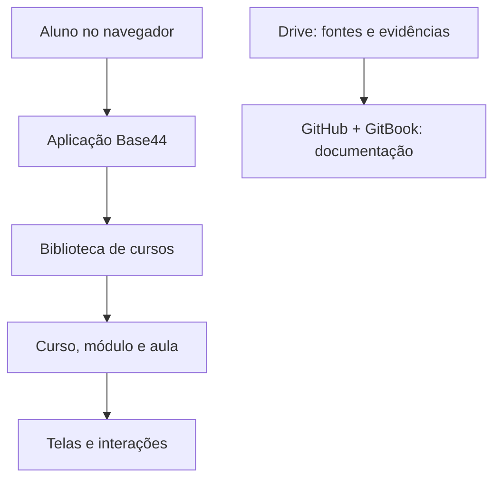

# Arquitetura funcional

## Visão geral

A aplicação é desenvolvida na **Base44**, e sua documentação está neste **GitBook**, sincronizado com um repositório **GitHub**. O Google Drive guarda materiais internos, debates e evidências. Esses são sistemas diferentes, com responsabilidades distintas.

O desenho representa **camadas funcionais do projeto**, não uma inspeção validada de infraestrutura de produção. Não presume banco de dados, APIs próprias ou integração entre Drive e Base44.

## Hierarquia de conteúdo adotada

**Biblioteca → Curso independente → Módulo → Aula → Tela interativa**.

A **Saga do Dinheiro** é um curso introdutório separado de **Fundamentos dos Investimentos**. A Saga utiliza narrativa e intuição; Fundamentos deve aprofundar conceitos, critérios de escolha e cálculos. Essa divisão pedagógica ainda precisa ser refletida e testada integralmente no catálogo publicado.

## Componentes identificados no material técnico

O inventário da Saga cita componentes como **Palpite**, **Decision**, **Explore**, **FormulaBlock**, simuladores, **Timeline** e **SagaFinal**. Regimes de juros, inflação e poder de compra foram explorados em atividades interativas. A correspondência entre código e cada tela deve continuar documentada por aula.

| Camada | Responsabilidade | Verificação |
| --- | --- | --- |
| Interface | Navegação, cards de cursos, player e feedback | Parcialmente observada |
| Conteúdo educacional | Textos, fórmulas, questões e estados por tela | Inventário disponível; revisão em andamento |
| Estado e progresso | Acompanhamento por usuário | Persistência **não comprovada** |
| Autenticação | Acesso e identidade | Relatada historicamente; reteste necessário |
| Documentação | Requisitos, decisões, versões, testes e evidências | GitHub ↔ GitBook sincronizados |

## Regras de integridade técnica

- Resolver rotas por **IDs reais** das aulas; evitar montar destinos a partir de números presumidos.
- Não exibir porcentagens de progresso demonstrativas como dados reais.
- Manter separadas as informações acadêmicas internas e o conteúdo público.
- Registrar a origem de cada status de implementação.
- Versionar atualizações antes de declarar funcionalidades concluídas.

**Fontes:** inventário técnico relatado pelo Base44; Documento 07 (03/11); repositório GitHub conectado ao GitBook.
