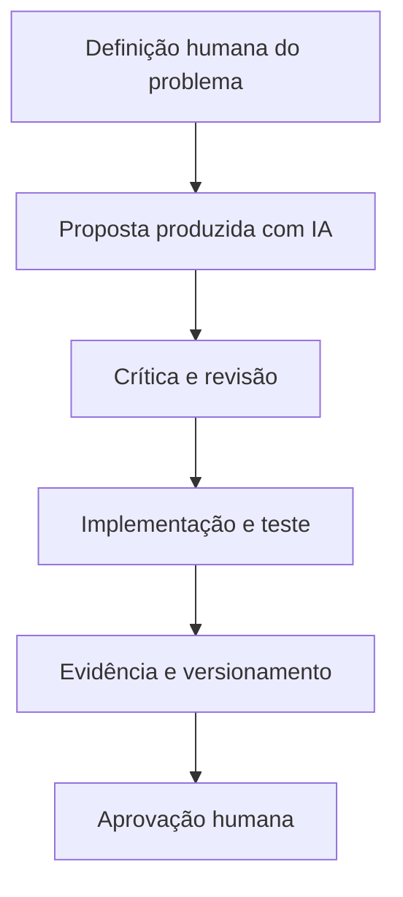

# Inteligência artificial e automação

## Dois usos diferentes da IA

1. **IA no desenvolvimento do projeto:** apoio à escrita, estrutura pedagógica, programação, análise de inconsistências e documentação.
2. **IA como funcionalidade para o aluno:** proposta de assistente educacional para tirar dúvidas e explicar conceitos, **não verificada como integrada ao app**.

Misturar esses dois usos poderia levar a banca a acreditar que o aplicativo possui funcionalidades ainda não implementadas.

## Fluxo de desenvolvimento assistido

No trabalho documentado, **ChatGPT** apoiou coordenação e diagnóstico, **Gemini** participou de propostas pedagógicas e **Base44** foi utilizada para integrar conteúdo ao aplicativo. A contribuição específica de outros agentes só deve ser registrada quando existir parecer e confirmação de entrega no Drive.

## Hipótese de assistente educacional futuro

- Explicar termos financeiros com linguagem adequada ao iniciante.
- Usar exemplos numéricos e mostrar fórmulas quando necessário.
- Informar incerteza e solicitar revisão humana de conteúdo sensível.
- Não recomendar ativos específicos nem prometer lucros.
- Não executar compra, venda ou movimentação financeira.

## Riscos e controles

| Risco | Controle proposto |
| --- | --- |
| Resposta financeiramente incorreta | Verificação por fontes e revisão pedagógica |
| Fórmula ou cálculo errado | Testes de casos-limite e comparação com resultados conhecidos |
| Conteúdo inventado sobre funcionalidades | Etiquetas “observado”, “reportado”, “planejado” |
| Uso indevido de dados pessoais | Minimização, dados fictícios e revisão de compartilhamento |
| Falha repetida entre agentes | Registro de erro, causa, correção, teste e lição reutilizável |


**IA não substitui a responsabilidade do grupo.** O professor exige ferramenta, finalidade, prompt, resultado, revisão e validação humana para usos relevantes. O [registro de uso de IA](15-uso-de-ia.md) apresenta esse protocolo.


**Relação acadêmica:** Inteligência Artificial e Automação; Ferramentas No-Code e IA Generativa; Ética e Segurança Digital.
