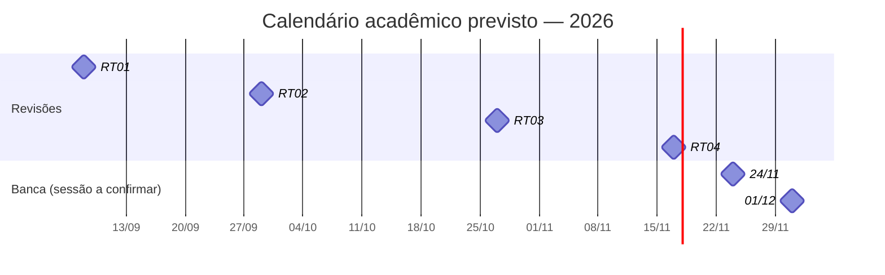

# 12 — Cronograma, entregas e Gantt

**Projeto:** Escola de Investimentos Brasil  
**Coordenação:** a confirmar na ficha oficial do grupo  
**Período acadêmico de referência:** setembro a dezembro de 2026  
**Progresso geral:** a apurar — os percentuais por tarefa ainda não foram validados.

## Marcos definidos no calendário acadêmico

| Marco | Data informada | Entrega / finalidade | Situação de submissão |
| --- | --- | --- | --- |
| RT01 | 08/09/2026 | Ficha, proposta A3 e definição de grupo | A confirmar |
| RT02 | 29/09/2026 | Entregáveis, proposta e pesquisa | A confirmar |
| RT03 | 27/10/2026 | Entregáveis do projeto | A confirmar |
| RT04 | 17/11/2026 | Entregáveis do projeto | Planejamento em andamento; submissão não verificada |
| Banca — sessão 1 | 24/11/2026 | Apresentações por grupos | A confirmar se corresponde ao grupo |
| Banca — sessão 2 | 01/12/2026 | Apresentações por grupos | A confirmar se corresponde ao grupo |

## Linha do tempo dos marcos

## Plano de atividades — controle inicial

| Ordem | Etapa | Atividade | Responsável | Início | Término | % executado | Status |
| ---: | --- | --- | --- | --- | --- | ---: | --- |
| 1 | Início | Validar requisitos do projeto e situação das RT01–RT03 | A definir | A definir | A definir | — | A confirmar |
| 2 | Desenvolvimento | Consolidar biblioteca de cursos independentes | A definir | A definir | A definir | — | Em andamento |
| 3 | Desenvolvimento | Validar Saga do Dinheiro como curso separado | A definir | A definir | A definir | — | Em revisão |
| 4 | Desenvolvimento | Concluir a revisão pedagógica da Aula 4 | A definir | A definir | A definir | — | Pendente de aprovação |
| 5 | Desenvolvimento | Produzir a Aula 5 após aprovação da Aula 4 | A definir | A definir | A definir | 0% | Bloqueada |
| 6 | Desenvolvimento | Integrar as aulas restantes | A definir | A definir | A definir | — | Em andamento |
| 7 | Documentação | Atualizar GitBook com evolução, evidências e status | A definir | 03/11/2026 | A definir | — | Em andamento |
| 8 | Revisão final | Auditoria simulada como aluno | A definir | Após concluir aulas | A definir | 0% | Não iniciada |
| 9 | Entrega acadêmica | Preparar RT04 | A definir | A definir | 17/11/2026 | — | Planejada |
| 10 | Banca | Preparar demonstração com evidências e contingência | A definir | A definir | A confirmar | — | Não iniciada |

### Status e cores do controle tipo Smartsheet

| Cor | Significado |
| --- | --- |
| 🟢 Verde | Concluído ou em andamento dentro do prazo |
| 🟡 Amarelo | Exige atenção ou depende de validação |
| 🔴 Vermelho | Prazo vencido e tarefa não concluída |
| ⚪ Cinza | Não iniciado / tarefa futura |

A tabela acima é a **visão documental inicial**. O Gantt por tarefa, calculado por datas e com edição de responsáveis, status e percentual, deverá ser mantido em planilha conectada. Não há percentuais inventados para produzir um gráfico aparentemente concluído.

**Fonte:** Documentação A3 (RT01–RT04 e banca), item 7–8; Documento 07 (03/11/2026); calendário a confirmar com o professor.