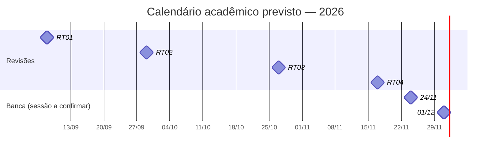

# Cronograma e Gantt

### Vídeo demonstrativo — Seu dinheiro tem uma história

Filme conceitual da Escola de Investimentos Brasil. 54 segundos, 720p, com animação e trilha instrumental, sem locução. As cenas representam a proposta de aprendizagem e não são gravações da interface real.



[Assistir ou baixar o MP4](https://drive.google.com/file/d/1fHIy_GS86nPyjog-6wTD87OhcBE1Nnxs/view)

**Projeto:** Escola de Investimentos Brasil\
**Coordenação:** a confirmar na ficha oficial do grupo\
**Período acadêmico de referência:** setembro a dezembro de 2026\
**Progresso geral:** a apurar — os percentuais por tarefa ainda não foram validados.

## Marcos definidos no calendário acadêmico

| Marco            | Data informada | Entrega / finalidade                    | Situação de submissão                               |
| ---------------- | -------------- | --------------------------------------- | --------------------------------------------------- |
| RT01             | 08/09/2026     | Ficha, proposta A3 e definição de grupo | A confirmar                                         |
| RT02             | 29/09/2026     | Entregáveis, proposta e pesquisa        | A confirmar                                         |
| RT03             | 27/10/2026     | Entregáveis do projeto                  | A confirmar                                         |
| RT04             | 17/11/2026     | Entregáveis do projeto                  | Planejamento em andamento; submissão não verificada |
| Banca — sessão 1 | 24/11/2026     | Apresentações por grupos                | A confirmar se corresponde ao grupo                 |
| Banca — sessão 2 | 01/12/2026     | Apresentações por grupos                | A confirmar se corresponde ao grupo                 |

## Linha do tempo dos marcos

### Plano de atividades — controle inicial

Atualizado em 16/11/2026 para corresponder à aba **Plano de Trabalho** do Excel. As datas de início e término abaixo são **planejamento proposto**, alinhado ao calendário acadêmico. A atribuição de responsabilidade não comprova conclusão, aprovação pedagógica ou submissão. Percentuais continuam a apurar.

| Ordem | Etapa                               | Atividade                                                  | Responsáveis                                 | Início planejado | Término planejado | % executado | Situação             |
| ----: | ----------------------------------- | ---------------------------------------------------------- | -------------------------------------------- | ---------------- | ----------------- | ----------: | -------------------- |
|     1 | Concepção e início do projeto       | Conferir problema, público-alvo e objetivos                | Equipe                                       | 01/09/2026       | 08/09/2026        |           — | Execução a verificar |
|     2 | Concepção e início do projeto       | Conferir ficha oficial, integrantes e escopo mínimo        | Equipe                                       | 01/09/2026       | 08/09/2026        |           — | Execução a verificar |
|     3 | Definição e planejamento do projeto | Consolidar pesquisa e fontes de educação financeira        | Caio Roque de Menezes                        | 09/09/2026       | 22/09/2026        |           — | Execução a verificar |
|     4 | Definição e planejamento do projeto | Definir requisitos, critérios de aceite e tecnologias      | Equipe                                       | 09/09/2026       | 22/09/2026        |           — | Execução a verificar |
|     5 | Definição e planejamento do projeto | Planejar atividades, datas, recursos e riscos              | Bernardo Ferreira Veloso                     | 23/09/2026       | 29/09/2026        |           — | Execução a verificar |
|     6 | Definição e planejamento do projeto | Validar distribuição funcional com os cinco integrantes    | Equipe                                       | 09/09/2026       | 15/09/2026        |           — | Execução a verificar |
|     7 | Lançamento e execução do projeto    | Consolidar biblioteca de cursos independentes              | Antonio Carlos Caldas                        | 30/09/2026       | 13/10/2026        |           — | Execução a verificar |
|     8 | Lançamento e execução do projeto    | Validar Saga do Dinheiro como curso separado               | Caio Roque de Menezes; Antonio Carlos Caldas | 14/10/2026       | 20/10/2026        |           — | Execução a verificar |
|     9 | Lançamento e execução do projeto    | Concluir revisão pedagógica da Aula 4                      | Caio Roque de Menezes; Vinicius Barros Noman | 21/10/2026       | 23/10/2026        |           — | Execução a verificar |
|    10 | Lançamento e execução do projeto    | Produzir Aula 5 após aprovação da Aula 4                   | Caio Roque de Menezes; Antonio Carlos Caldas | 24/10/2026       | 27/10/2026        |           — | Execução a verificar |
|    11 | Lançamento e execução do projeto    | Produzir e integrar as aulas restantes                     | Antonio Carlos Caldas; Caio Roque de Menezes | 28/10/2026       | 10/11/2026        |           — | Execução a verificar |
|    12 | Desempenho e controle do projeto    | Atualizar documentação, evidências e registro de uso de IA | Bernardo Ferreira Veloso                     | 30/09/2026       | 17/11/2026        |           — | Execução a verificar |
|    13 | Desempenho e controle do projeto    | Revisar requisitos, acessibilidade, ética e segurança      | Vinicius Barros Noman                        | 14/10/2026       | 17/11/2026        |           — | Execução a verificar |
|    14 | Desempenho e controle do projeto    | Apurar percentuais e submissões em cada RT                 | Equipe                                       | 08/09/2026       | 17/11/2026        |           — | Execução a verificar |
|    15 | Desempenho e controle do projeto    | Executar auditoria geral simulando um aluno                | Vinicius Barros Noman                        | 11/11/2026       | 16/11/2026        |           — | Execução a verificar |
|    16 | Encerramento do projeto             | Consolidar material RT04 e conferir submissão              | Bernardo Ferreira Veloso; Equipe             | 10/11/2026       | 17/11/2026        |           — | Execução a verificar |
|    17 | Encerramento do projeto             | Preparar apresentação, demonstração e contingência         | Jackson Silva Nunes Neto; Equipe             | 18/11/2026       | 24/11/2026        |           — | Execução a verificar |
|    18 | Encerramento do projeto             | Confirmar data da banca e presença dos integrantes         | Equipe                                       | 16/11/2026       | 23/11/2026        |           — | Execução a verificar |
|    19 | Encerramento do projeto             | Registrar conclusão, pendências e lições aprendidas        | Equipe                                       | 25/11/2026       | 01/12/2026        |           — | Execução a verificar |

**Equipe:** Caio Roque de Menezes, Bernardo Ferreira Veloso, Vinicius Barros Noman, Antonio Carlos Caldas e Jackson Silva Nunes Neto. Nas linhas com “Equipe”, a responsabilidade é compartilhada pelos cinco integrantes.

#### Atuação informada por integrante

| Integrante               | Frente de atuação                                 | Atividades atribuídas                                                                                    |
| ------------------------ | ------------------------------------------------- | -------------------------------------------------------------------------------------------------------- |
| Caio Roque de Menezes    | Pesquisa e conteúdo educacional                   | Pesquisa, fontes e organização dos conteúdos educacionais. Apoio à Saga do Dinheiro e produção de aulas. |
| Bernardo Ferreira Veloso | Documentação e planejamento                       | Documentação no GitBook, cronograma, Plano de Trabalho e organização da RT04.                            |
| Vinicius Barros Noman    | Qualidade e validação                             | Conferência de requisitos, qualidade, revisão pedagógica e auditoria do percurso do aluno.               |
| Antonio Carlos Caldas    | Coordenação do trabalho e desenvolvimento técnico | Coordenação do trabalho, desenvolvimento técnico e integração da plataforma Base44 e das aulas.          |
| Jackson Silva Nunes Neto | Comunicação e apresentação                        | Comunicação, sequência das falas, roteiro e preparação da demonstração e apresentação.                   |

A atuação acima corresponde à distribuição de funções informada pela equipe. Resultados individuais e conclusão devem ser associados às evidências do projeto.

#### Datas de referência conferidas

| Marco            | Data       |
| ---------------- | ---------- |
| RT01             | 08/09/2026 |
| RT02             | 29/09/2026 |
| RT03             | 27/10/2026 |
| RT04             | 17/11/2026 |
| Banca — sessão 1 | 24/11/2026 |
| Banca — sessão 2 | 01/12/2026 |

Fonte: foto do Plano de Aula 2026/2, professor Mário Sérgio Caldas Teixeira, enviada em 16/11/2026. A sessão de banca atribuída ao grupo permanece a confirmar.

**Dependências:** a Aula 5 depende da aprovação da Aula 4; a auditoria geral como aluno depende da produção de todas as aulas.

### Status e cores do controle tipo Smartsheet

| Cor         | Significado                               |
| ----------- | ----------------------------------------- |
| 🟢 Verde    | Concluído ou em andamento dentro do prazo |
| 🟡 Amarelo  | Exige atenção ou depende de validação     |
| 🔴 Vermelho | Prazo vencido e tarefa não concluída      |
| ⚪ Cinza     | Não iniciado / tarefa futura              |

📊 Cronograma em Excel

Consulte o cronograma visual e as abas do Plano de Trabalho na planilha original.

[Abrir planilha do Plano de Trabalho](https://docs.google.com/spreadsheets/d/1DsgU0vpYi3u_O-PA8ZD1TmhxQJ237pyw/edit)

A tabela acima é a visão documental inicial. O Gantt por tarefa, calculado por datas e com edição de responsáveis, status e percentual, deverá ser mantido em planilha conectada. Não há percentuais inventados para produzir um gráfico aparentemente concluído.
